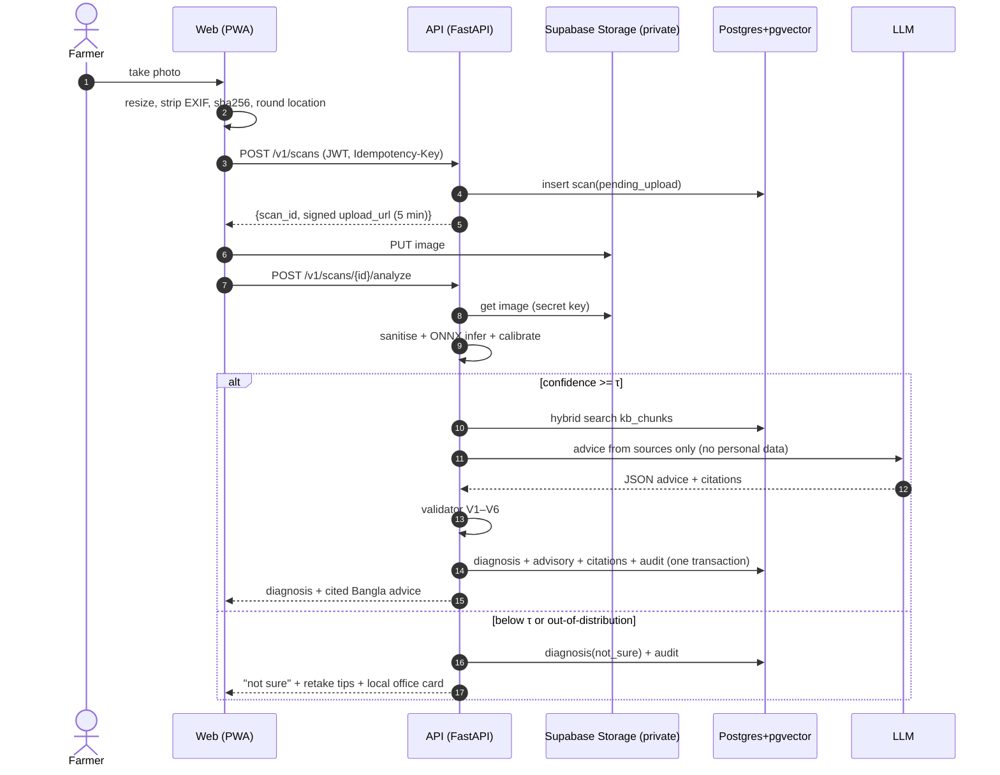
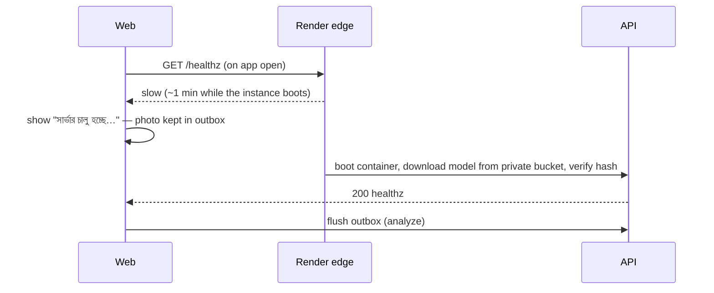
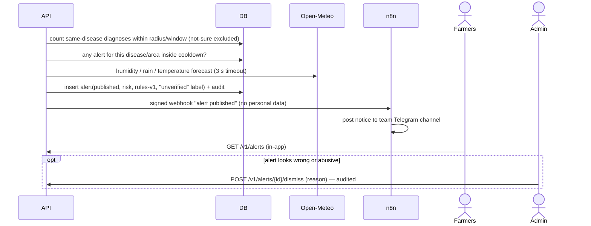
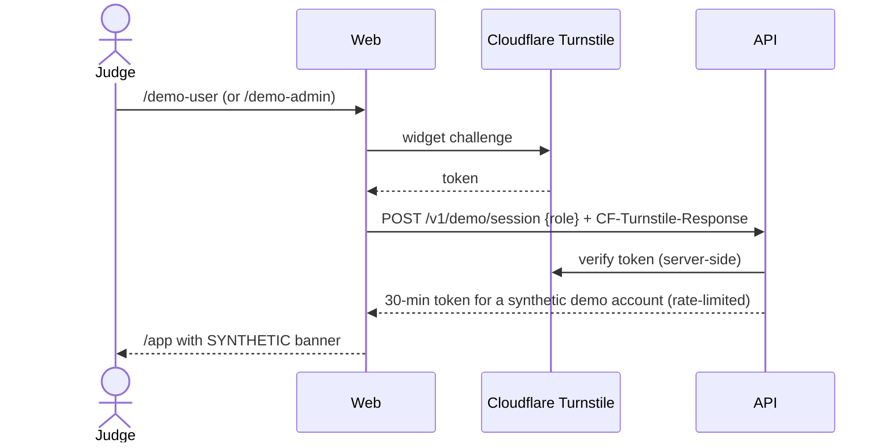
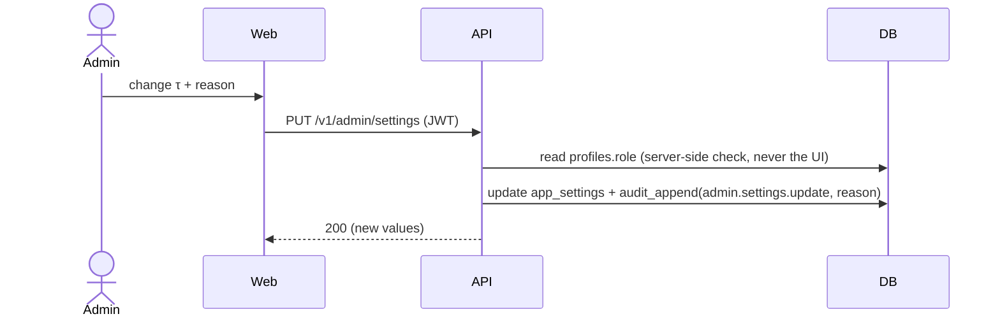

# Sequence diagrams

## 1. Scan → diagnosis → advice (warm server)

## 2. Cold start (Render free, after 15 min idle)

## 3. Automatic outbreak alert

## 4. One-click demo (with CAPTCHA)

## 5. Admin action (audited)

