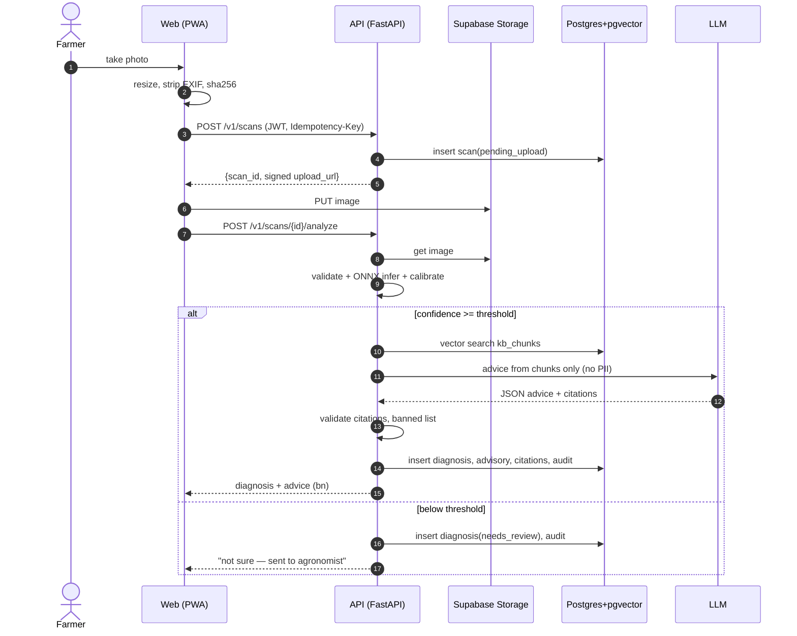
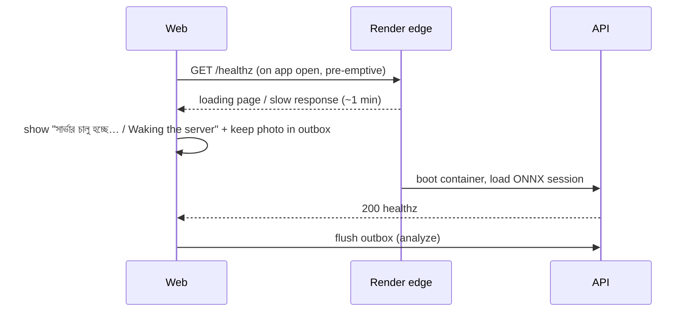
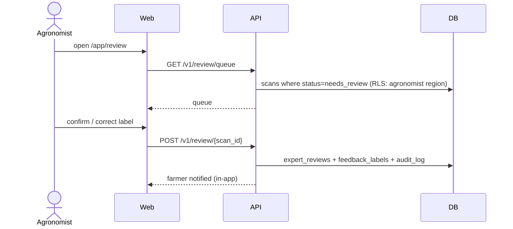
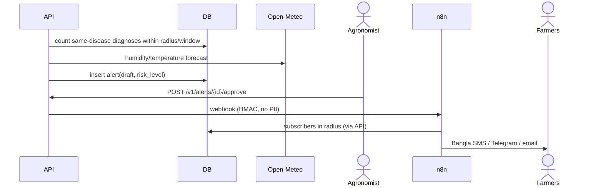
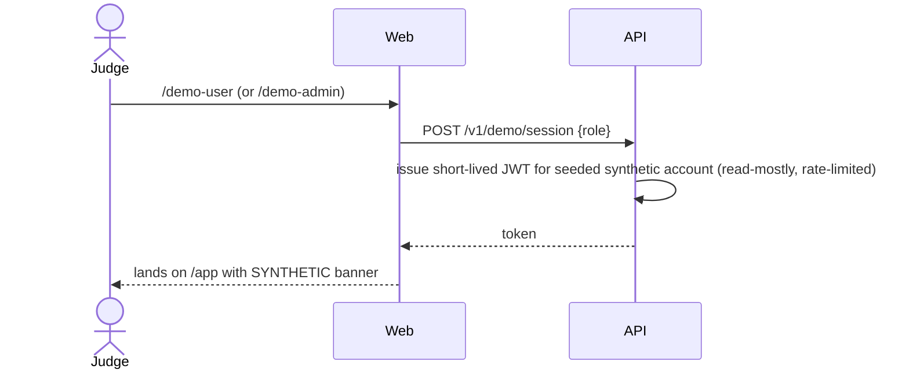

# Sequence diagrams

## 1. Scan → diagnosis → advice (happy path, warm server)

## 2. Cold start (Render free, after 15 min idle)

## 3. Human review loop

## 4. Outbreak alert

## 5. One-click demo

