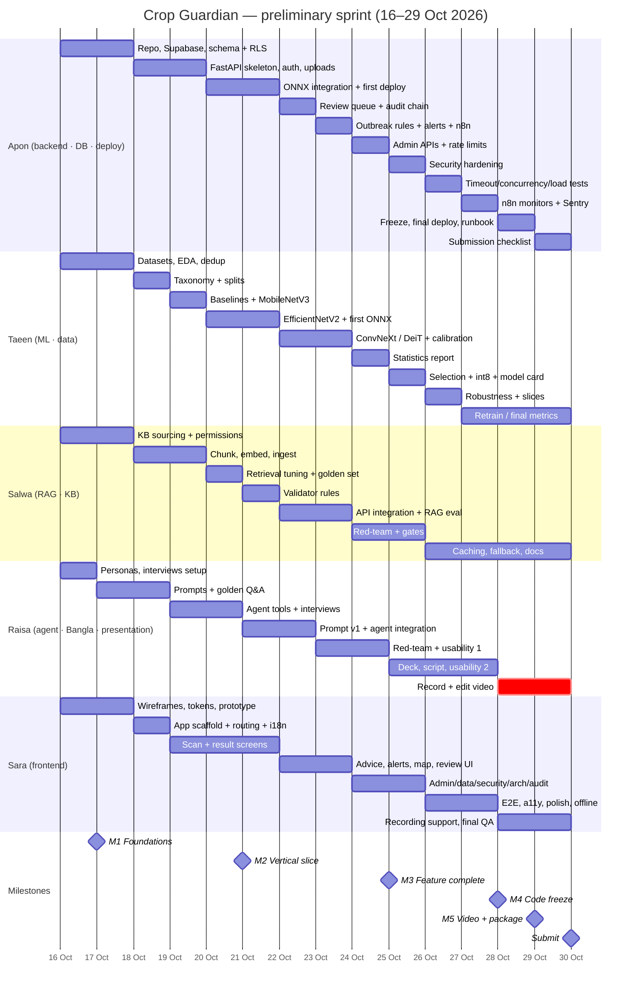

# Gantt — 16 to 29 October 2026 (preliminary submission sprint)

Deadline: **31 Oct 2026, 12:00 BST** (S1 §5 timeline). Internal deadline **29 Oct 22:00**;
30 Oct = submission day; 31 Oct morning = emergency buffer only.

**Members:** Apon (lead · backend · DB · ML integration · deploy) · Taeen (ML training · data ·
backend support) · Salwa (AI — RAG & KB) · Raisa (AI — agent & Bangla · presentation) · Sara (frontend lead).

## Milestones
| ID | Date | Milestone | Exit criterion |
|---|---|---|---|
| M1 | Sat 17 Oct | Foundations | repo, Supabase schema applied, datasets downloaded, wireframes approved |
| M2 | Wed 21 Oct | **Vertical slice deployed** | photo → (baseline) model → diagnosis shown on Render URL |
| M3 | Sun 25 Oct | Feature complete | advisory with citations, review queue, alerts, admin/audit pages |
| M4 | Wed 28 Oct | **Code freeze** | all hard test gates green; only bug fixes after |
| M5 | Thu 29 Oct | Video + package ready | 3-min video exported; checklist complete |
| SUB | Fri 30 Oct | **Submit** | form submitted; public URLs verified from a phone |

## Day-by-day plan

| Date | Apon | Taeen | Salwa | Raisa | Sara |
|---|---|---|---|---|---|
| **Fri 16** | Kick-off; assign roles; create GitHub repo from this template; Supabase project + region; Render workspace | Download D1, D2, D3; checksums; start D4 licence check | List KB sources (DAE/BRRI/BARI); request permissions; start collecting PDFs | Problem statement & personas review; book farmer/extension-officer interviews | Wireframes for scan → result → advice; design tokens; Bangla font |
| **Sat 17** | Apply `db/schema.sql` + RLS; buckets; seed reference data; CI skeleton **(M1)** | EDA notebook: counts, sizes, brightness, blur; pHash dedup | Text extraction (Bangla OCR test) on first 5 docs | Advisory system-prompt v0 + JSON schema; Bangla style guide | Clickable prototype review with team; finalize bn/en copy keys **(M1)** |
| **Sun 18** | FastAPI skeleton: config, `/healthz`, `/readyz`, JWT verify, role guard | Unified taxonomy + split v1 (group-stratified); datasheet | Chunking + metadata tagging; embed with multilingual-e5 | Write 20 golden Q&A pairs with an agronomist contact | React/Vite app scaffold; routing for all 14 routes; i18n setup |
| **Mon 19** | `POST /v1/scans` + signed upload URLs; upload sanitiser; idempotency | Baseline 1: handcrafted features + SVM; Baseline 2: MobileNetV3 on Colab | pgvector ingest; hybrid retrieval query; first retrieval eval | Agent tool definitions (`get_diagnosis`, `search_kb`…) with Apon | Scan screen: camera/file input, compression, EXIF strip, outbox |
| **Tue 20** | ONNX inference module + thread pool; Dockerfile; first Render deploy | EfficientNetV2-B0 training; export first ONNX for integration | Retrieval tuning (top-k, RRF, min score); golden set to 40 pairs | User interviews (2–3), notes anonymised | Result screen: top-3, confidence band, abstain state |
| **Wed 21** | Wire web ↔ API ↔ Supabase; CORS; **vertical slice live (M2)** | Integrate ONNX with Apon; parity check; preprocessing identical | `rag/validator.py` rules; banned-ingredient list | Prompt v1 tested on golden set; Bangla quality review | Waking-server state, error states, history list **(M2)** |
| **Thu 22** | Review queue API + expert_reviews/feedback_labels; audit chain | ConvNeXt-T and DeiT-S runs (5-fold); temperature scaling | Integrate retrieval into API advisory service | Integrate agent loop in API with Salwa; fallback cards for 7 diseases | Advice screen with citations; voice playback (TTS bn-BD) |
| **Fri 23** | Outbreak rules v1 + Open-Meteo; alerts API; n8n alert workflow | Risk–coverage → τ; OOD set from PlantDoc; Grad-CAM gallery | RAG eval: Recall@8, MRR, faithfulness | Agent red-team cases with Salwa | Alerts screen + map (Leaflet + OSM tiles); review queue UI |
| **Sat 24** | Admin APIs (users, thresholds, model versions, KB docs); rate limiting | Statistics report: CIs, McNemar, confusion matrix, slices, confound probe | Prompt-injection & poisoned-chunk tests; fix findings | Usability session 1 on prototype (farmers/officers) | Admin, Data, Security, Architecture pages |
| **Sun 25** | Security hardening: headers, CSP, HMAC webhooks, secret scan; RLS tests **(M3)** | Select model by rule; int8 export; model card filled with measured values | Citation coverage & banned-leakage gates green | Pitch storyline; slide deck v1 | Audit page (one-click report), Presentation & Pitchdeck pages **(M3)** |
| **Mon 26** | Timeout + concurrency tests; k6 load test on Render; cold-start fixes | Robustness tests (blur/brightness/rotation); per-group results | Caching + fallback paths; LLM provider switch test | Video script (180 s, §9.2 segments); usability session 2 | Playwright E2E (bn + en, phone viewport); a11y fixes |
| **Tue 27** | n8n: keep-warm, heartbeat, digest, synthetic monitor; Sentry | Retrain with any agronomist-labelled pilot photos (if available); update eval | Docs: rag-design results, eval tables | Deck v2; demo script; rehearse | Polish: performance (Lighthouse), offline PWA, copy review |
| **Wed 28** | **Code freeze (M4)**; final deploy; runbook dry-run (rollback, Supabase restore) | Final metrics into docs + `/data` page; reproducibility check | Final red-team run; sign-off on advice safety | Record video takes; screen captures from live app | Record UI walkthrough clips; bug-fix only |
| **Thu 29** | Submission checklist; verify all public URLs from a phone on mobile data **(M5)** | Model card + datasheet final; licences/attributions | Final docs review (AI sections) | **Edit and export 3-min video (M5)** | Final visual QA in both locales; screenshots for deck |
| Fri 30 | **Submit** with Raisa; confirm receipt | standby | standby | **Submit** with Apon | standby |
| Sat 31 | Buffer until 12:00 BST — emergency fixes only | | | | |

## Gantt chart (Mermaid — renders on GitHub; drawn as a grid in the PDF report)

## Critical path
KB sourcing (Salwa, 16–19) → validator (21) → advisory integration (22) → citation gates (25).
Dataset → model → ONNX (Taeen, 16–20) → integration (Apon, 21). If either slips by > 1 day,
cut stretch items in this order: voice playback → map tiles → Grad-CAM gallery → ConvNeXt/DeiT runs.

## Status tracking
Each evening, mark your cell: ✅ done · 🟡 partial · 🔴 blocked (with reason in stand-up notes).
