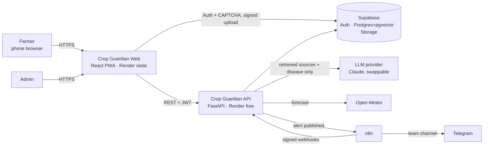

# Crop Guardian — System Design Document (SDD)

| | |
|---|---|
| Version | 1.1 · 16 October 2026 |
| Status | **Design — not yet built.** The repository is a docs-only template; no figure in this document is a measured result. |
| Owners | Apon (overall, backend, DB, deploy) · Taeen (ML) · Salwa & Raisa (AI) · Sara (frontend) |
| Challenge | AgriSphere AI → **Crop Guardian**: early pest and disease detection from imagery (S1 §6.4) |

Sources are referenced as `[S#]`, `[D#]`, `[R#]` → [`docs/research/sources.md`](../research/sources.md).

---

## 1. Problem

A smallholder sees spots on a rice leaf. Today the options are: guess, ask a neighbour, ask a
pesticide dealer who profits from the sale, or wait for an extension officer. By the time a
correct diagnosis arrives the disease may have spread — local blast outbreaks have been
reported to cut yield by up to 80 % in affected places [S3], and state institutes describe a
worst case of up to 62 % loss if major disease outbreaks are frequent [S2]. No precise national
yield-loss figure for rice diseases exists [S4] — the data to measure the problem is itself
missing.

Agriculture is Bangladesh's largest employing sector, about 45 % of employment in 2022 [S5].

**Problem statement.** *Farmers lack a fast, trustworthy, Bangla-language way to identify crop
disease from what they can see, and nobody aggregates individual sightings into early outbreak
warnings for the surrounding area.*

## 2. Users and personas
Full personas: [`docs/product/personas.md`](../product/personas.md).

| Persona | Needs | Primary surface |
|---|---|---|
| **Farmer** (smallholder, low-end Android, intermittent 3G/4G, Bangla, may have low literacy) | Photo → answer in Bangla, voice, icons, what to do today; honest "not sure" | `/app` (PWA) |
| **Admin** (Crop Guardian operator — the team) | Thresholds, model versions, knowledge-base documents, users, dismiss a wrong alert, audit | `/admin`, `/data`, `/security`, `/audit` |
| **Judge / evaluator** | One-click entry, see it work, see the architecture | `/demo-user`, `/demo-admin`, `/architecture` |

## 3. Scope
**In scope (preliminary, 31 Oct):** rice — the classes covered by datasets D1 + D2 (blast, brown
spot, narrow brown spot, bacterial leaf blight, sheath blight, tungro, healthy). Photo diagnosis
with calibrated confidence and an honest **"not sure"** answer, cited Bangla advisory, scan
history, automatic rule-based outbreak alerts (in-app, clearly labelled unverified), admin, audit.
**Web only.**

**Out of scope:** any human expert review step, other crops, drone/satellite imagery, IoT sensors,
native apps, SMS broadcasting, payments, marketplace. Precision Farm advisory is a future domain pack
(ADR 0010).

## 4. Success metrics (KPIs)
Every target below is a **target**, not a result.

| KPI | Definition | How measured |
|---|---|---|
| Diagnostic macro-F1 (field images) | macro-F1 on held-out **field** test split (D1 + D2, never seen in training) | evaluation report with 95 % bootstrap CI |
| Selective accuracy & coverage | accuracy on the cases the model answers, and the share it answers | evaluation at chosen τ |
| Not-sure rate in use | share of real scans answered "not sure" | API counts (weekly drift workflow) |
| Time to advice | p95 photo-submitted → advice-shown (warm server) | API timing logs |
| Citation coverage | share of advisories with ≥ 1 valid citation | must be **100 %** (hard gate) |
| Alert dismiss rate | share of published alerts the admin had to dismiss | admin log |
| **Field loss reduction** (winning signal) | pilot vs comparison plots | post-preliminary pilot — **not claimed before measured** |

## 5. Requirements

### 5.1 Functional
| ID | Requirement | Route |
|---|---|---|
| F1 | Sign in with email OTP (protected by CAPTCHA); demo user/admin with one click (CAPTCHA) | `/demo-user`, `/demo-admin` |
| F2 | Capture or upload a leaf photo; compress client-side; queue offline | `/app/scan` |
| F3 | Return top-3 diseases with calibrated confidence and a heat-map where available | `/app/result/:id` |
| F4 | Below threshold → **"not sure"**: retake tips + local agriculture office card; no disease named as the answer | `/app/result/:id` |
| F5 | Bangla advisory with citations, dosage and safety line; voice playback | `/app/result/:id` |
| F6 | Scan history | `/app/history` |
| F7 | Automatic outbreak alerts from rules, labelled "possible outbreak — unverified, rule-based", in-app | `/app/alerts` |
| F8 | Admin: thresholds, model versions, KB documents, users/roles, dismiss alert — every action audited | `/admin` |
| F9 | Data lineage, datasets, KB inventory | `/data` |
| F10 | Security & responsible-AI controls page | `/security` |
| F11 | System architecture page | `/architecture` |
| F12 | One-click audit report | `/audit` |
| F13 | Product story & pitch deck | `/presentation`, `/pitchdeck` |

### 5.2 Non-functional
| Attribute | Requirement | Design response |
|---|---|---|
| Language | Bangla default; English alternate | i18n keys, Bangla source locale (ADR 0007) |
| Low bandwidth | usable on slow 3G | upload ≈ 150–300 KB after compression; service-worker cache |
| Offline | capture works offline | IndexedDB outbox (ADR 0009) |
| Latency | warm p95 scan < 5 s; cold start handled gracefully | ONNX int8 on CPU; "waking server" UI; keep-warm |
| Availability | demo-grade on free tiers | static frontends never sleep; API cold start ≈ 1 min [R1]; backup hosting runbook |
| Security | the 19-point security checklist + OWASP Top 10 + LLM Top 10 | [`security-checklist.md`](../security/security-checklist.md) |
| Privacy | minimise PII; strip EXIF; coarse geo | [`privacy.md`](../security/privacy.md) |
| Explainability | confidence + heat-map + model version on every result; sources on every advice | ADR 0005, 0006 |
| Cost | ৳0 infrastructure for the prototype | Render free + Supabase free + free automation |

## 6. Architecture

### 6.1 Context

Diagram sources: [`docs/diagrams/`](../diagrams/). Detail: [`system-overview.md`](../architecture/system-overview.md).

### 6.2 Layers (mapped to the Congress reference architecture, S1 §7)
| Congress layer | Crop Guardian component |
|---|---|
| User interaction | React PWA, Bangla, voice playback, offline outbox |
| Application logic | FastAPI modular monolith: `auth`, `scans`, `diagnoses`, `advisory`, `alerts`, `admin`, `audit` |
| AI intelligence | Vision classifier (ONNX) · calibration & abstain · advisory LLM agent |
| Knowledge retrieval | pgvector over DAE/BRRI/BARI guides, citation enforcement |
| Agent orchestration | Advisory agent with 4 read-only tools |
| Data infrastructure | Supabase Postgres (relational + vector), private Storage (images, model weights) |
| Automation & integration | n8n: alert notice, digest, drift, keep-warm, heartbeat, monitors |
| Deployment | Render static sites + Render free Docker web service; Supabase free |

### 6.3 Why a modular monolith, not microservices
One free Render instance, 750 instance-hours/month [R1], five people, two weeks. Microservices
would multiply cold starts and hours. Module boundaries are enforced so a later split is mechanical.
ADR 0002.

## 7. Data flow
Walkthrough: [`data-flow.md`](../architecture/data-flow.md) · sequences: [`sequence-diagrams.md`](../architecture/sequence-diagrams.md).

1. **Capture** — browser compresses to ≤ 1024 px JPEG, strips EXIF, computes SHA-256, rounds location to 2 decimals.
2. **Upload** — API issues a 5-minute signed URL to the private `scans` bucket; browser uploads directly.
3. **Validate** — API checks magic bytes, size, dimensions, re-encodes; idempotent on `(user_id, sha256)`.
4. **Infer** — ONNX session → temperature-scaled softmax → top-3; out-of-distribution guard.
5. **Decide** — max prob ≥ τ → `diagnosed`; else **`not_sure`** with retake tips and the local office card (ADR 0005).
6. **Advise** — retrieve Bangla KB chunks → LLM writes advice **only from chunks** → validator rejects uncited/unsafe output.
7. **Store** — diagnosis, advisory, citations, audit row in one transaction.
8. **Cluster** — count non-abstained diagnoses of the same notifiable disease within radius/window.
9. **Alert** — threshold met and no alert in cooldown → **publish** in-app alert labelled unverified,
   rule-based; n8n posts a notice to the team channel; admin may dismiss (audited).
10. **Improve** — models are retrained on public datasets; usage statistics (not user photos) inform priorities.

## 8. Data model
Spec: [`db/SCHEMA-SPEC.md`](../../db/SCHEMA-SPEC.md) · dictionary: [`erd.md`](../data/erd.md).
Entities: `profiles` · `consents` · `crops` · `disease_catalog` · `farms` · `fields` · `scans` ·
`diagnoses` · `model_versions` · `advisories` · `citations` · `kb_documents` · `kb_chunks` (vector) ·
`alerts` · `alert_preferences` · `app_settings` · `audit_log`.

## 9. API design
Full contract: [`services/api/SPEC.md`](../../services/api/SPEC.md) §4 (17 endpoints). Summary:

| Method & path | Purpose | Auth | Budget |
|---|---|---|---|
| `GET /healthz`, `GET /readyz` | liveness / readiness | none | 0.2 s / 2 s |
| `POST /v1/demo/session` | one-click demo | CAPTCHA, rate-limited | 2 s |
| `POST /v1/scans` · `POST /v1/scans/{id}/analyze` · `GET /v1/scans[/{id}]` | scan lifecycle | owner | 2 s / 25 s / 2 s |
| `GET /v1/alerts` · `PUT /v1/me/alert-preference` | alerts | farmer | 2 s |
| `POST /v1/alerts/{id}/dismiss` | operator kill-switch | admin | 2 s |
| `/v1/admin/*` | settings, models, KB, users, digest, drift | admin | 3 s |
| `GET /v1/audit/report` | one-click audit | admin, demo | 10 s |
| `POST /v1/hooks/n8n/{event}` | automation | signed webhook | 3 s |

Errors are RFC 9457 problem+json. Every write accepts `Idempotency-Key`.

## 10. AI & ML
Details: [`vision-model.md`](../ai/vision-model.md) · [`statistics.md`](../ai/statistics.md) ·
[`rag-design.md`](../ai/rag-design.md) · [`agent-design.md`](../ai/agent-design.md) ·
[`eval-plan.md`](../ai/eval-plan.md) · [model cards](../ai/model-cards/README.md).

### 10.1 Vision — algorithm selection
| Candidate | Family | Why consider | Risk |
|---|---|---|---|
| Colour/texture features + SVM | classical | tiny, explainable baseline | low ceiling |
| **MobileNetV3-Large** | CNN, mobile | tiny, fast on CPU | lower ceiling |
| **EfficientNetV2-B0** | CNN, compound-scaled | strong accuracy/size; D1 authors used EfficientNet-V2 [P1] | slightly heavier |
| **ConvNeXt-Tiny** | modern CNN | texture-rich images | may be slow on free CPU |
| **DeiT-Small / ViT-S/16** | Vision Transformer | global context | data-hungry |

**Selection rule** (fixed before test): int8 ONNX ≤ 30 MB and CPU latency ≤ 1 s → highest mean
validation macro-F1 → ties by lower ECE, then smaller model → evaluate once on test.

### 10.2 Statistics
Group-stratified splits with near-duplicate removal, 5-fold CV, macro-F1, per-class recall, confusion
matrix, ECE, temperature scaling, bootstrap 95 % CI, McNemar's test, confound probe, lab→field
domain shift. [`statistics.md`](../ai/statistics.md).

### 10.3 Outbreak risk
Rules v1 (radius, window, minimum reports, cooldown, weather favourability from cited sources) →
automatic publish with the "unverified, rule-based" label. LightGBM v2 only when outcome data exists.

### 10.4 Advisory LLM + RAG
Bangla-capable embeddings in pgvector; hybrid retrieval; LLM (Claude `claude-sonnet-5-5`,
swappable) generates **only from retrieved chunks**; validator V1–V6 blocks uncited, banned or unsafe
output → fallback card "contact your local agriculture office".

### 10.5 Agent
One bounded **Advisory Agent** with read-only tools `get_diagnosis`, `search_kb`, `get_weather`,
`get_field_history`; max 4 calls; no write tools. [`agent-design.md`](../ai/agent-design.md).

## 11. Security
All 19 checklist items + threat model: [`security-checklist.md`](../security/security-checklist.md) ·
[`threat-model.md`](../security/threat-model.md) · [`owasp-mapping.md`](../security/owasp-mapping.md).

## 12. Deployment
Zero to deployment: [`00-zero-to-deploy.md`](../deployment/00-zero-to-deploy.md) · Render:
[`01-render-guide.md`](../deployment/01-render-guide.md) · Supabase:
[`02-supabase-guide.md`](../deployment/02-supabase-guide.md) · other platforms:
[`03-other-platforms-guide.md`](../deployment/03-other-platforms-guide.md) · free-tier challenges:
[`04-free-tier-challenges.md`](../deployment/04-free-tier-challenges.md).

## 13. Testing
[`test-strategy.md`](../testing/test-strategy.md) · [`security-testing-guide.md`](../testing/security-testing-guide.md) ·
case tables in [`tests/`](../../tests/README.md).

## 14. Responsible AI & data sovereignty
[`responsible-ai.md`](../ai/responsible-ai.md) · [`data-sovereignty.md`](../data/data-sovereignty.md).
Abstain-don't-guess; cited advice only; per-group evaluation; alerts labelled unverified; farmer owns
photos (delete on request); coarse location; no data sale; dataset licences recorded.

## 15. Capacity estimate (prototype)
Assumptions, not measurements: 200 demo users × 5 scans/day → 1,000 scans/day × ≈ 250 KB ≈ 250 MB
of Storage per month — this would exceed the free 1 GB storage in about 4 months, so originals older
than 90 days are reduced to thumbnails. DB rows are small; a few thousand 384-d vectors fit easily in
500 MB [R2]. Keep API traffic moderate: Render may suspend a free service for unusually high outbound
traffic to external databases/APIs [R1].

## 16. Risks & plan
[`04-free-tier-challenges.md`](../deployment/04-free-tier-challenges.md) ·
[`risk-register.md`](../plan/risk-register.md) · Gantt 16–29 Oct: [`gantt.md`](../plan/gantt.md) ·
RACI: [`raci.md`](../plan/raci.md).

## 17. Glossary
| Term | Meaning |
|---|---|
| Not sure (abstain) | the model declines to name a disease when calibrated confidence is below τ |
| ECE | expected calibration error — gap between confidence and accuracy |
| RAG | retrieval-augmented generation — the LLM answers from retrieved documents |
| RLS | Postgres row-level security |
| DAE / BRRI / BARI | Department of Agricultural Extension / Bangladesh Rice Research Institute / Bangladesh Agricultural Research Institute |
