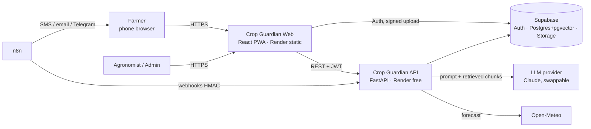

# Crop Guardian — System Design Document (SDD)

| | |
|---|---|
| Version | 1.0 · 16 October 2026 |
| Status | **Design — not yet built.** No figure in this document is a measured result. |
| Owners | Apon (overall, backend, DB, deploy) · Taeen (ML) · Salwa & Raisa (AI) · Sara (frontend) |
| Challenge | AgriSphere AI → **Crop Guardian**: early pest and disease detection from imagery (S1 §6.4) |

Sources are referenced as `[S#]`, `[D#]`, `[R#]` → [`docs/research/sources.md`](../research/sources.md).

---

## 1. Problem

A smallholder sees spots on a rice leaf. Today the options are: guess, ask a neighbour, ask a
pesticide dealer who profits from the sale, or wait for an extension officer. By the time a
correct diagnosis arrives the disease may have spread — local blast outbreaks have been
reported to cut yield by up to 80 % in affected places [S3], and state institutes describe a
worst case of up to 62 % loss if major disease outbreaks are frequent [S2]. No precise national
yield-loss figure for rice diseases exists [S4] — the data to measure the problem is itself
missing.

Agriculture is Bangladesh's largest employing sector, about 45 % of employment in 2022 [S5].

**Problem statement.** *Farmers lack a fast, trustworthy, Bangla-language way to identify crop
disease from what they can see, and nobody aggregates individual sightings into early outbreak
warnings for the surrounding area.*

## 2. Users and personas
Full personas: [`docs/product/personas.md`](../product/personas.md).

| Persona | Needs | Primary surface |
|---|---|---|
| **Farmer** (smallholder, low-end Android, intermittent 3G/4G, Bangla, may have low literacy) | Photo → answer in Bangla, voice, icons, what to do today | `/app` (PWA) |
| **Agronomist / extension officer** (SAAO, DAE) | Queue of uncertain cases, confirm/correct, see outbreaks in their union/upazila | `/app/review`, `/app/alerts`, `/admin` (alert drafts) |
| **Admin** (Crop Guardian operator) | Users, roles, model versions, KB documents, thresholds, audit | `/admin`, `/data`, `/security`, `/audit` |
| **Judge / evaluator** | One-click entry, see it work, see the architecture | `/demo-user`, `/demo-admin`, `/architecture` |

## 3. Scope
**In scope (preliminary, 31 Oct):** rice — the classes covered by datasets D1 + D2 (blast,
brown spot, narrow brown spot, bacterial leaf blight, sheath blight, tungro, healthy).
Photo diagnosis, abstain + human review, cited Bangla advisory, scan history, outbreak map and
alerts, admin, audit. **Web only.**

**Out of scope now:** other crops (added as data allows), drone/satellite imagery, IoT
sensors, native apps, payments, marketplace. Precision Farm advisory is a future domain pack
(ADR 0010).

## 4. Success metrics (KPIs)
Every target below is a **target**, not a result. Baselines are measured in Phase 3/4.

| KPI | Definition | How measured |
|---|---|---|
| Diagnostic macro-F1 (field images) | macro-F1 on held-out **field** test split (D1 + D2, never seen in training) | `ml/evaluation/` report, with 95 % bootstrap CI |
| Abstain precision | share of abstained cases that an agronomist confirms were genuinely hard/wrong | review log |
| Selective accuracy | accuracy on the cases the model *does* answer | eval at chosen threshold |
| Time to advice | p95 photo-submitted → advice-shown (warm server) | API timing logs |
| Citation coverage | share of advisories with ≥ 1 valid citation | must be **100 %** (hard gate) |
| Alert lead time | days between first cluster alert and agronomist-confirmed outbreak | pilot |
| **Field loss reduction** (winning signal) | yield/loss comparison of pilot farmers vs. matched control plots | Phase 4–5 pilot with an extension office — **cannot be claimed before then** |

## 5. Requirements

### 5.1 Functional
| ID | Requirement | Route |
|---|---|---|
| F1 | Sign up / sign in with phone OTP or email; demo users with one click | `/demo-user`, `/demo-admin` |
| F2 | Capture or upload a leaf photo; compress client-side; queue offline | `/app/scan` |
| F3 | Return top-3 diseases with calibrated confidence and a heat-map | `/app/result/:id` |
| F4 | Abstain below threshold → "not sure" → agronomist queue | `/app/review` |
| F5 | Bangla advisory with citations, dosage and safety line; voice playback | `/app/result/:id` |
| F6 | Scan history per farmer and per field | `/app/history` |
| F7 | Outbreak clustering and alerts to subscribers within a radius | `/app/alerts` |
| F8 | Agronomist confirms/corrects → feedback label | `/app/review` |
| F9 | Admin: users, roles, thresholds, model versions, KB documents | `/admin` |
| F10 | Data lineage, datasets, KB inventory | `/data` |
| F11 | Security & responsible-AI controls page | `/security` |
| F12 | System architecture page | `/architecture` |
| F13 | One-click audit report | `/audit` |
| F14 | Product story & pitch deck | `/presentation`, `/pitchdeck` |

### 5.2 Non-functional
| Attribute | Requirement | Design response |
|---|---|---|
| Language | Bangla default; English alternate | i18n keys, `bn.json` source locale (ADR 0007) |
| Low bandwidth | usable on slow 3G | upload ≤ ~300 KB after compression; static assets cached by service worker |
| Offline | capture works offline; sync later | IndexedDB outbox + background sync (ADR 0009) |
| Latency | warm p95 scan < 5 s; cold start handled gracefully | ONNX int8 on CPU; "waking server" UI; keep-warm ping |
| Availability | demo-grade on free tier | static frontend never sleeps; API cold start ≤ ~1 min [R1] |
| Security | OWASP Top 10 + LLM Top 10 addressed | [`docs/security/owasp-mapping.md`](../security/owasp-mapping.md) |
| Privacy | minimise PII; strip EXIF; coarse geo | [`docs/security/privacy.md`](../security/privacy.md) |
| Explainability | every diagnosis shows confidence + heat-map; every advice shows sources | ADR 0005, 0006 |
| Cost | ৳0 infrastructure for the prototype | Render free + Supabase free + n8n self-host/free tier |

## 6. Architecture

### 6.1 Context

Diagram sources: [`docs/diagrams/`](../diagrams/). Detail: [`docs/architecture/system-overview.md`](../architecture/system-overview.md).

### 6.2 Layers (mapped to the Congress reference architecture, S1 §7)
| Congress layer | Crop Guardian component |
|---|---|
| User interaction | React PWA, Bangla, voice playback, offline outbox |
| Application logic | FastAPI modular monolith: `auth`, `scans`, `diagnoses`, `advisory`, `alerts`, `review`, `admin`, `audit` |
| AI intelligence | Vision classifier (ONNX) · Grad-CAM · advisory LLM agent |
| Knowledge retrieval | pgvector over DAE/BRRI/BARI guides, citation enforcement |
| Agent orchestration | Advisory agent with 4 read-only tools + 1 human-gated draft tool |
| Data infrastructure | Supabase Postgres (relational + vector), Storage (images, model weights) |
| Automation & integration | n8n: alerts, digest, drift, keep-warm, monitors |
| Deployment | Render static site + Render free Docker web service; Supabase free |

### 6.3 Why a modular monolith, not microservices
One free Render instance, 750 instance-hours/month [R1], five people, two weeks. Microservices
would multiply cold starts and hours. Module boundaries are enforced in code (no cross-module
DB access) so a later split is mechanical. ADR 0002.

## 7. Data flow
Full walkthrough with sequence diagrams: [`docs/architecture/data-flow.md`](../architecture/data-flow.md),
[`docs/architecture/sequence-diagrams.md`](../architecture/sequence-diagrams.md).

1. **Capture** — browser compresses to ≤ 1024 px JPEG, strips EXIF, computes SHA-256.
2. **Upload** — API issues a signed Storage URL (`POST /v1/scans` → `{scan_id, upload_url}`);
   browser PUTs the image directly to Supabase Storage (API never buffers large bodies).
3. **Validate** — API re-checks magic bytes, size, dimensions; idempotency on `(user_id, sha256)`.
4. **Infer** — ONNX session (loaded once per process) → logits → temperature-scaled softmax
   → top-3. Optional "is this a leaf?" gate.
5. **Decide** — max prob ≥ threshold → `diagnosed`; else `needs_review` (ADR 0005).
6. **Explain** — Grad-CAM heat-map computed offline per model version for the demo; at runtime
   a lightweight saliency map (or none) — honest about cost on CPU.
7. **Advise** — retrieve top-k chunks for (disease, crop, growth stage) in Bangla → LLM writes
   advice **only from chunks**, returns citations → validator rejects uncited output.
8. **Store** — `scans`, `diagnoses`, `advisories`, `citations`; location rounded to ~1 km.
9. **Cluster** — on insert, count confirmed/high-confidence diagnoses of the same disease within
   `OUTBREAK_RADIUS_KM` over `OUTBREAK_WINDOW_DAYS`; threshold crossed → `alerts` draft.
10. **Alert** — agronomist approves draft → n8n webhook fans out to subscribers.
11. **Learn** — agronomist label → `feedback_labels` → export to next training set.

## 8. Data model (ER + schema)
Full ERD and table dictionary: [`docs/data/erd.md`](../data/erd.md). DDL: [`db/schema.sql`](../../db/schema.sql).
RLS: [`db/rls_policies.sql`](../../db/rls_policies.sql).

Core entities: `profiles` (1:1 auth user, role) · `farms` · `fields` · `crops` ·
`scans` · `diagnoses` · `disease_catalog` · `advisories` · `citations` · `kb_documents` ·
`kb_chunks` (vector) · `expert_reviews` · `feedback_labels` · `alerts` · `alert_subscriptions` ·
`model_versions` · `consents` · `audit_log`.

## 9. API design
Full contract: [`services/api/openapi-outline.md`](../../services/api/openapi-outline.md).

| Method & path | Purpose | Auth | Timeout budget |
|---|---|---|---|
| `GET /healthz` | liveness (no DB) | none | 200 ms |
| `GET /readyz` | DB + model loaded | none | 2 s |
| `POST /v1/demo/session` | one-click demo user/admin | none, rate-limited | 2 s |
| `POST /v1/scans` | create scan, get signed upload URL | farmer | 2 s |
| `POST /v1/scans/{id}/analyze` | run inference + advisory | owner | 25 s total (4 s infer, 20 s LLM) |
| `GET /v1/scans/{id}` | scan + diagnosis + advisory | owner / agronomist | 2 s |
| `GET /v1/scans` | history (paginated) | owner | 2 s |
| `GET /v1/review/queue` | abstained cases | agronomist | 2 s |
| `POST /v1/review/{scan_id}` | confirm/correct label | agronomist | 2 s |
| `GET /v1/alerts` | alerts near me | farmer | 2 s |
| `POST /v1/alerts/{id}/approve` | approve draft → n8n | agronomist | 3 s |
| `POST /v1/hooks/n8n/{event}` | inbound automation (HMAC) | HMAC | 3 s |
| `GET/PUT /v1/admin/*` | users, thresholds, models, KB | admin | 3 s |
| `GET /v1/audit/report` | one-click audit JSON/HTML | admin | 10 s |

Errors follow RFC 9457 problem+json. Every write accepts `Idempotency-Key`.

## 10. AI & ML
Details: [`docs/ai/vision-model.md`](../ai/vision-model.md), [`docs/ai/statistics.md`](../ai/statistics.md),
[`docs/ai/rag-design.md`](../ai/rag-design.md), [`docs/ai/agent-design.md`](../ai/agent-design.md),
[`docs/ai/eval-plan.md`](../ai/eval-plan.md), model cards in [`docs/ai/model-cards/`](../ai/model-cards/).

### 10.1 Vision — algorithm selection
| Candidate | Family | Why consider | Risk |
|---|---|---|---|
| **MobileNetV3-Large** | CNN, mobile | tiny, fast on CPU, good transfer | lower ceiling |
| **EfficientNetV2-B0** | CNN, compound-scaled | strong accuracy/size trade-off; authors of D1 used EfficientNet-V2 [P1] | slightly heavier |
| **ConvNeXt-Tiny** | modern CNN | strong on texture-rich images | ~28 M params — may be slow on free CPU |
| **DeiT-Small / ViT-S/16** | Vision Transformer | global context, strong with pre-training | data-hungry; small datasets |
| *Stretch:* **YOLOv8n** | detector | lesion boxes → severity % | needs box labels we do not have yet |

**Selection rule** (decided before seeing test results, to avoid cherry-picking): highest
macro-F1 on the *validation* split among models whose int8 ONNX file ≤ 30 MB and CPU latency
≤ 1 s per image; ties → better calibration (lower ECE). Then evaluate once on test.

Training: ImageNet-pretrained backbone, two-stage fine-tune (head, then last blocks), AdamW,
cosine LR, label smoothing 0.1, class-weighted loss or balanced sampler, augmentations that
match field reality (random resized crop, colour jitter, blur, rotation, shadow), mixed precision
on free Colab/Kaggle GPU. Export: ONNX → dynamic int8 quantisation → parity check vs. FP32.

### 10.2 Statistics
Stratified split by **source image group** (no near-duplicates across splits — perceptual-hash
dedup), 5-fold CV for model selection, macro-F1 + per-class recall + confusion matrix,
expected calibration error, temperature scaling, bootstrap 95 % CI, McNemar's test between the
top two models, and a **lab→field domain-shift** experiment (train with PlantVillage, test on
field data) reported honestly. [`docs/ai/statistics.md`](../ai/statistics.md).

### 10.3 Outbreak risk
Stage 1 (now): rule-based spatial-temporal clustering (DBSCAN-style radius/window) + weather
conditions favourable to the disease (humidity/temperature from Open-Meteo) → risk level.
Stage 2 (when labels exist): gradient-boosted model (LightGBM) on cluster + weather features.
Stage-1 output is labelled "rule-based".

### 10.4 Advisory LLM + RAG
Bangla-capable embeddings (multilingual-e5) in pgvector; hybrid retrieval (vector + keyword);
LLM (Claude `claude-sonnet-5-5`, provider-swappable) generates **only from retrieved chunks**;
output schema `{advice_bn, steps[], dosage, safety, citations[]}`; validator rejects any
response without citations or containing a banned active ingredient → fallback message
"consult your agronomist" + escalation.

### 10.5 Agents
One bounded **Advisory Agent** (Raisa) with tools: `get_diagnosis`, `search_kb`,
`get_weather`, `get_field_history` (read-only) and `create_alert_draft` (human approval
required). No autonomous external actions. [`docs/ai/agent-design.md`](../ai/agent-design.md).

## 11. Security
STRIDE threat model, OWASP mapping, privacy: [`docs/security/`](../security/).
Highlights: Supabase Auth JWT + role claims; RLS on every table; service-role key only on the
server; signed upload URLs; upload sanitisation; rate limits; HMAC on n8n webhooks; prompt-
injection isolation; hash-chained audit log; secrets in Render env groups; CSP and security
headers on the static site.

## 12. Deployment
[`docs/deployment/render-guide.md`](../deployment/render-guide.md) ·
**[`docs/deployment/challenges-and-recovery.md`](../deployment/challenges-and-recovery.md)**.
Static frontend + one Docker API service on Render free; Supabase for everything stateful;
model weights in the image (or pulled from Storage at boot); n8n keep-warm during demo windows.

## 13. Testing
[`docs/testing/test-strategy.md`](../testing/test-strategy.md) — unit, whitebox, blackbox,
integration, contract, timeout, concurrency, load, security (SAST/DAST/LLM red-team), ML
robustness and fairness, E2E (Playwright), manual scripts, n8n synthetic monitors.

## 14. Responsible AI & data sovereignty
[`docs/ai/responsible-ai.md`](../ai/responsible-ai.md) · [`docs/data/data-sovereignty.md`](../data/data-sovereignty.md).
Abstain-don't-guess; cited advice only; per-group evaluation (crop variety, region, phone
quality, lighting); farmer owns their photos (delete on request); location coarsened; no
selling of data; licences of every dataset recorded.

## 15. Capacity estimate (prototype)
Assumptions, not measurements: 200 demo users, 5 scans/user/day → 1,000 scans/day; ~250 KB
per compressed image → ~250 MB/month of Storage — **this would exceed the free 1 GB storage
in ~4 months**, so images older than 90 days are downscaled to thumbnails unless labelled.
DB rows are tiny; vectors: a few thousand chunks × 384 dims fits easily within 500 MB [R2].

## 16. Risks
Top risks and recoveries: [`docs/deployment/challenges-and-recovery.md`](../deployment/challenges-and-recovery.md)
and [`docs/plan/risk-register.md`](../plan/risk-register.md).

## 17. Plan
16–29 Oct day-by-day Gantt per member: [`docs/plan/gantt.md`](../plan/gantt.md). RACI:
[`docs/plan/raci.md`](../plan/raci.md).

## 18. Glossary
| Term | Meaning |
|---|---|
| Abstain | model declines to answer when calibrated confidence is below threshold |
| ECE | expected calibration error — gap between confidence and accuracy |
| RAG | retrieval-augmented generation — LLM answers from retrieved documents |
| RLS | Postgres row-level security |
| SAAO | Sub-Assistant Agriculture Officer (DAE field extension) |
| DAE / BRRI / BARI | Department of Agricultural Extension / Bangladesh Rice Research Institute / Bangladesh Agricultural Research Institute |
