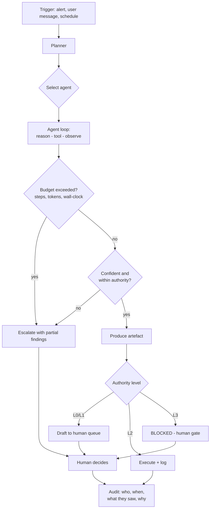

# Agentic AI Design

> Governing decision: [ADR 0010](../architecture/adr/0010-human-in-the-loop-gates.md) —
> no agent moves money without a human gate.

## 1. Why agents at all

An agent earns its place only where a task requires **multi-step reasoning with tool use
and an uncertain path**. Where the path is known, a function is better: cheaper, faster,
testable, and it cannot surprise anyone.

Applying that test honestly:

| Task | Agent? | Why |
|---|---|---|
| Compute FX conversion | **No** | Deterministic arithmetic |
| Rank routes by predicted cost | **No** | Model inference plus a sort |
| Investigate an AML alert | **Yes** | Path depends on what each lookup reveals |
| Answer "why was my transfer held?" | **Yes** | Needs retrieval, case context, and Bangla explanation |
| Post a ledger entry | **No** | Must never be probabilistic |
| Reconcile a partner statement break | **Yes** | Requires hypothesis generation and iterative checking |

Five agents pass the test. Everything else is a function.

## 2. The agent roster

### 2.1 Compliance Agent — authority L1 (draft only)

Investigates AML alerts. Retrieves applicable rules with citations, pulls transaction and
counterparty history, queries the entity graph for network proximity, and assembles an
**evidence bundle**: what it found, what rule applies, what it recommends, and what it
could not determine.

It drafts. An officer decides. The agent never closes an alert.

The "could not determine" section is mandatory and is the most valuable part of the
bundle — an investigation that reports only what it found teaches the officer nothing
about where to look next.

### 2.2 Routing Agent — authority L2 (reversible acts)

Handles the cases the optimiser cannot express as a clean solve: no single compliant
path exists, a partner is degraded mid-flight, or a split must be proposed and explained.
Produces the **Bangla rationale** a user actually reads. It re-ranks and proposes; it
cannot execute a payout.

### 2.3 Support Agent — authority L0/L1

Answers user questions in Bangla, grounded in the user's own case data and the RAG
corpus. Can draft a refund or a case escalation; cannot issue one. Hard rule: it never
speculates about *why* a compliance decision was made — it reports the recorded reason or
escalates. Speculation about an AML hold is both a security leak and a legal problem.

### 2.4 Research Agent — authority L0

Monitors corridor costs, competitor pricing and regulatory change; produces the analyst
briefs that keep the fee model honest. Every claim attributed. Output is written to
`docs/research/data/` in the same cited format as the rest of the folder.

### 2.5 Reconciliation Agent — authority L1

Given a break between our ledger and a partner statement, generates ranked hypotheses
(timing, fee treatment, FX rounding, partial settlement, duplicate), tests each against
the journal, and proposes the correcting entry. A human posts it (ADR 0009: corrections
are compensating entries, never edits).

## 3. Tool surface (MCP registry)

Tools are declared with an authority level enforced **at the tool boundary**, not by
prompt instruction. A prompt that says "do not do X" is a request; a registry that
refuses X is a control.

| Tool | Level | Notes |
|---|---|---|
| `rag.search` | L0 | Citation-enforced |
| `graph.query` | L0 | Read-only Cypher, parameterised, allow-listed patterns |
| `ledger.read` | L0 | Projections only |
| `case.read` / `case.open` | L0 / L2 | Opening a case is reversible |
| `transfer.read` | L0 | Tokenised for external model calls |
| `notification.send` | L2 | Template-bound; no free-text to users without review |
| `sar.draft` | L1 | Draft only |
| `route.rerank` | L2 | Cannot execute |
| `transfer.release` / `transfer.block_override` | **L3** | **Human only. Not exposed to any agent.** |
| `ledger.post` | **L3** | **Human only.** |
| `limit.update` | **L3** | **Human only.** |

L3 tools are absent from the agent registry entirely. They are not present-but-refused;
an agent cannot see them.

## 4. Orchestration

Every agent run is bounded by steps, tokens and wall-clock. **Exhausting a budget
escalates with partial findings; it never silently gives up and it never returns a
fabricated conclusion.** Partial findings plus an honest "I ran out of road here" is a
useful artefact; a confident summary built on an incomplete investigation is a hazard.

## 5. Failure handling

| Failure | Response |
|---|---|
| Tool error | Retry with backoff ×2, then escalate with the error surfaced |
| Contradictory evidence | Do not resolve it — present both sides to the human |
| No relevant knowledge | `NOT_FOUND` → human. Never improvise |
| Budget exhausted | Escalate with partial findings |
| Suspected prompt injection in retrieved content | Halt, quarantine the document, raise a security event |
| Model unavailable | Degrade per the ladder in `system-overview.md` |

## 6. Evaluation

Agents are evaluated on **outcomes**, not fluency (`ml/evaluation/`):

| Metric | Target |
|---|---|
| Alert triage agreement with senior officer | ≥ 0.90 |
| Evidence-bundle completeness (rubric-scored) | ≥ 0.95 |
| Unsupported assertions per bundle | **0** |
| Escalation appropriateness | ≥ 0.95 |
| Reconciliation hypothesis hit-rate (top-3) | ≥ 0.85 |
| Bangla support-answer quality vs English | Δ ≤ 5 % |
| Authority violations attempted | **0** — any occurrence is a release blocker |

Red-team prompts live in `ml/evaluation/` and run in CI: injection via retrieved
documents, social-engineering a limit override, and attempts to elicit another user's
data.
