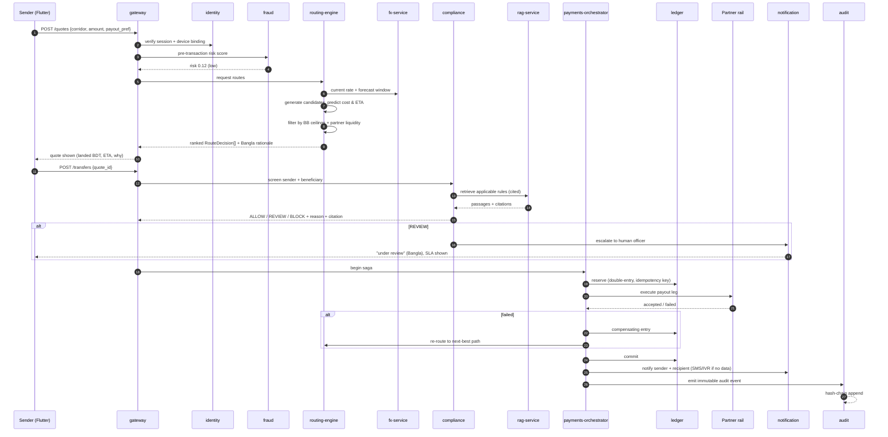
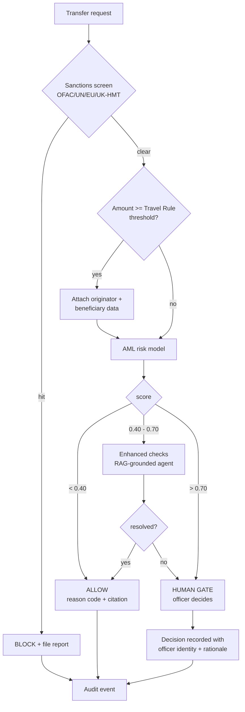
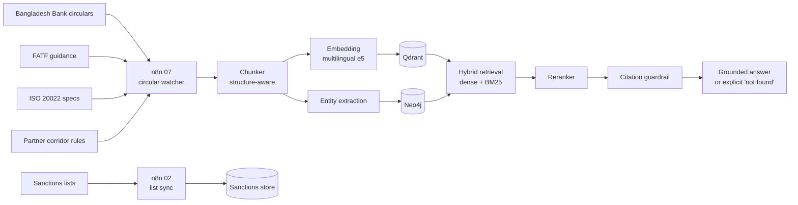

# Data Flow — how money and data actually move

## 1. The end-to-end send, as a sequence

**The step that does not exist in competing products is 9–11**: candidate generation,
ML cost/ETA prediction, and constraint filtering *before* the user sees a price. Most
products show one price from one rail and discover the constraint failure later.

## 2. Compliance decision flow

Every terminal state writes an audit event carrying: the model version, the retrieved
citations, the reason code, and — where a human decided — who decided and why. This is
what makes the `/audit` report generatable rather than reconstructed.

## 3. Knowledge (RAG) ingestion flow

**The guardrail is non-negotiable in a regulated domain.** If no retrieved passage
clears the citation threshold, the service returns *not found* and the request escalates
to a human. It never generates an ungrounded compliance opinion. A confident wrong
answer about an AML rule is worse than no answer.

## 4. Data classification and residency

| Class | Examples | Residency | Encryption | Retention |
|---|---|---|---|---|
| **C1 Identity** | NID number, passport, biometric template | Bangladesh only, never leaves | Field-level AES-256, separate key | Per BFIU requirement |
| **C2 Financial** | Amounts, beneficiary account, ledger entries | Bangladesh only | At-rest AES-256 | 5+ years, regulatory |
| **C3 Behavioural** | Device, session, in-app events | In-country preferred | At-rest | 24 months |
| **C4 Derived** | Risk scores, model features | In-country | At-rest | Model lifetime |
| **C5 Public** | FX rates, corridor fee benchmarks, circulars | Unrestricted | — | Indefinite |

**Rule:** classes C1–C4 never enter a third-party LLM prompt. Where an LLM is needed on
a record, the record is tokenised first and only C5 plus tokens leave the boundary. See
`docs/security/data-sovereignty.md` for the enforcement mechanism.

## 5. Event catalogue (Kafka topics)

| Topic | Emitted by | Consumed by | Key |
|---|---|---|---|
| `transfer.requested` | gateway | fraud, compliance, audit | `transfer_id` |
| `transfer.quoted` | routing-engine | analytics, audit | `quote_id` |
| `compliance.decided` | compliance | orchestrator, audit, reporting | `transfer_id` |
| `ledger.entry.posted` | ledger | reporting, reconciliation | `entry_id` |
| `payout.initiated` | orchestrator | notification, audit | `transfer_id` |
| `payout.settled` | orchestrator | ledger, reconciliation, notification | `transfer_id` |
| `payout.failed` | orchestrator | routing-engine, notification, audit | `transfer_id` |
| `model.prediction.made` | model serving | drift monitor, audit | `prediction_id` |
| `model.drift.detected` | n8n 09 | on-call, model registry | `model_name` |

All events are versioned, schema-registered in `data/schemas/`, and carry a
`correlation_id` that ties a user tap to every downstream consequence.
