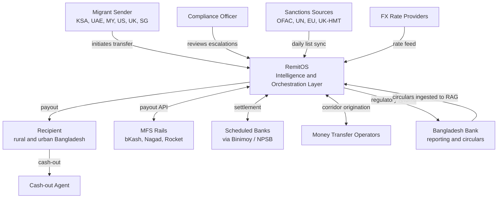
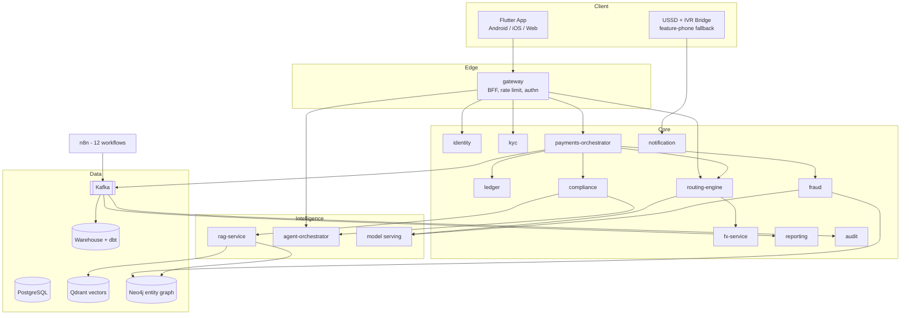
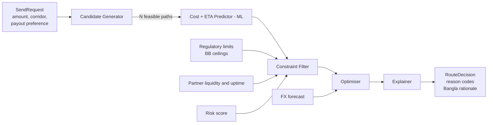

# System Overview — C4 Levels 1 to 3

## C4 Level 1 — System Context

## C4 Level 2 — Container view

## C4 Level 3 — Routing engine internals

The routing engine is the commercial core. It answers one question: given this send
request, which path delivers the most BDT to the recipient, soonest, legally?

### Why a constraint filter rather than post-hoc validation

Bangladesh Bank caps agent cash-out at Tk 30,000 per day and Tk 200,000 per month, and
caps a wallet balance at Tk 500,000. A naive product computes the cheapest route,
attempts it, and fails at the payout step — which in practice means the recipient stands
at an agent point and is told no. Encoding the ceilings as optimiser constraints means
the engine either finds a compliant single path, proposes a legal split across
endpoints, or tells the sender the truth **before** money moves.

This single design choice is the clearest illustration of the difference between a
system that has read the regulation and one that has only read the API docs.

## Service catalogue

| Service | Bounded context | Datastore | Notes |
|---|---|---|---|
| `gateway` | Edge | — | BFF; REST + GraphQL; per-user and per-corridor rate limits |
| `identity` | Who the user is | Postgres | OIDC, RBAC, device binding, step-up auth |
| `kyc` | Proving who they are | Postgres + object store | NID/passport OCR, liveness, screening hooks |
| `ledger` | What is owed | Postgres, event-sourced | Double-entry, idempotency keys, immutable journal |
| `payments-orchestrator` | Making it happen | Postgres | Saga with compensating transactions |
| `routing-engine` | Which path | Redis + model server | **Differentiator** |
| `fx-service` | What rate | Postgres + Redis | Quote, spread, hedge window |
| `compliance` | Is it allowed | Postgres | **Differentiator** — AML, Travel Rule, case management |
| `fraud` | Is it genuine | Redis + Neo4j | Real-time scoring, velocity, graph signals |
| `rag-service` | What the rules say | Qdrant + Neo4j | Citation-enforced retrieval |
| `agent-orchestrator` | Multi-step reasoning | Postgres | MCP tool registry, HITL gates |
| `notification` | Telling people | Postgres | Push, SMS, IVR, USSD; Bangla templates |
| `reporting` | Telling the regulator | Warehouse | Regulatory returns, settlement reports |
| `audit` | Proving what happened | Append-only store | Hash-chained; powers the audit report |

## Non-functional targets

| Attribute | Target | Rationale |
|---|---|---|
| Quote latency p95 | under 400 ms | The routing decision must feel instant |
| Payout initiation p95 | under 3 s | Perceived speed is the hundi-beating metric |
| Availability | 99.9 % core, 99.5 % intelligence | Intelligence degrades gracefully to rules |
| RPO / RTO | 0 / 15 min for ledger | Money state cannot be lost |
| Screen payload, low-bandwidth mode | under 50 KB | ~69 m mobile connections have no data plan |
| PII residency | in-country only | See `docs/security/data-sovereignty.md` |

## Graceful degradation ladder

AI is an enhancement, never a dependency for correctness. If the intelligence layer is
unavailable the system steps down, and tells the user it has:

1. **Full** — ML routing, RAG compliance, FX forecast
2. **Degraded** — cached model predictions, deterministic compliance rules
3. **Rules-only** — static routing table, conservative compliance, human review on all
   escalations
4. **Read-only** — new quotes disabled, existing transfers still settle and reconcile

At every level the ledger and the audit log remain authoritative. A system that cannot
explain what it did when its models are down is not production-grade.
